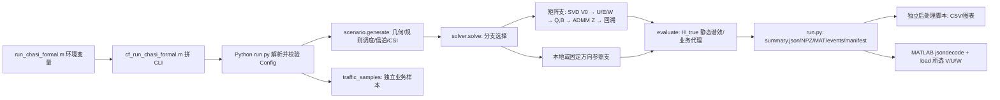
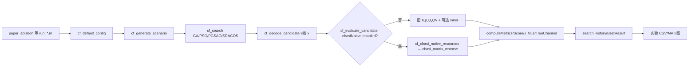

# 01 实际框架与执行顺序

仓库根 `D:\GitHubProjects\CF-MultiTRP-Optimization`，旧 CF 算法目录是 `matlab/core/`；CHASI Python 包是 `chasi_formal_implementation/`，实验入口是 `experiments/chasi_formal/`。审计时分支 `main`，远端 `origin/main`。所谓“CF 文件夹”在本仓库没有唯一同名目录，不能把旧 `matlab/core` 与 CHASI 合成一个求解器。[S: `setup_project_paths.m`; `experiments/chasi_formal/run_chasi_formal.m:1-43`; `matlab/core/cf_run_chasi_formal.m:1-65`]

## CHASI 真实调用图

`run.py:34-131` 建配置、`scenario.py:155-284` 生成场景和测量事件；`run.py:191-313` 逐分支调用 `solve`、`evaluate`，保存 `summary.json`、`events.json`、`scene_manifest.json`、每支的 `V/U/W/Serve/UE_ids/Rank` NPZ/MAT。CSV 和汇报图由 `show_presentation_evidence.py`、`final_figures_20261014/plot_final.py` 等独立后处理产生，不在 `run.py` 主函数内。`cf_run_chasi_formal.m:55-65` 读取结果。MATLAB CLI 只传标量/字符串配置，不传复数 H；Python 重新生成场景。`run_chasi_formal.m` 默认 ADMM 80 轮，Python CLI 直跑默认 12 轮，须记具体入口。`--time-evolution-tti>0` 才另跑 `time_evolution.simulate`，它不是冻结决策求解循环内的动态调度。

`scenario._geometry` → `_schedule` → 逐组服务掩码与 `H_true` → CSI-RS/SRS 观察、LMMSE 后验 `H_est,C` → `Resource`。关联和预分配在小尺度 H 之前形成；优化不决定服务集合或 rank。组是 SRS 对齐的 17 组，RB 宽为 16×16+17；`tx_rb_count` 可小于组宽。`solver.solve` 仅对固定服务掩码中的复矩阵 V 求解。`evaluate` 用 `H_true`、同一 V 和业务样本计算静态谱效与代理吞吐，`time_evolution` 是可选独立回放。

## 旧 MATLAB 链（另一实验轨道）

`cf_search.m:134-171` 候选评价调用 `cf_evaluate_candidate`。当且仅当 `cfg.chasiNative.enabled=true`，该评价器在第 4–6 行转入 `cf_evaluate_chasi_native_candidate` → `cf_chasi_native_resources` → `chasi_matrix_wmmse`，且目标改为估计 PF。默认未启用时走旧 `b/p/r/Q/W` 路；两支都不调用 Python `solver.py`。原生适配器要求显式调度/RB/误差规则，仅候选 `numConnections,maxRank` 进入原生求解，其他维度偏离默认会报错；轻量 smoke 已保存但不构成 21TRP 端到端证据。[S: `cf_evaluate_candidate.m:4-6`, `cf_evaluate_chasi_native_candidate.m`, `cf_chasi_native_resources.m`; R: `native_pf_20261014/README.md`] SRACOS 扩展见 `cf_sracos_guided_adaptive_gapso_search.m` 及 `cf_run_chasi_candidate.m`，需以具体实验入口识别是否启用。旧 `basic` 是 top-K 多 TRP/MRT 的高链路高功率基线，非严格单站独立功控。默认旧搜索 `Objective=SumRate/J_true`；原生条件分支改为 PF，不能混合比较。`Score` 在原生分支被置为同一 Objective。[S]

## 独立 MATLAB 求解模块和数据交换

`experiments/chasi_formal/migration_20261013/chasi_matrix_wmmse.m:1-126` 接收外供 `resources,cfg,initialV`，做矩阵 WMMSE/ADMM；有 PF、名义、统一及统计误差分支和静态真信道率。它已被 `cfg.chasiNative.enabled` 条件下的旧 MATLAB 候选评价器调用，但 **CHASI 21TRP 的 `run_chasi_formal.m` 仍不调用它**。`export_scene_to_matlab.py` 是独立导出工具；`native_pf_20261014` 小夹具对拍是局部验证，不是 210 UE 端到端迁移。[S,R]

## 规模区分

研究目标为 7站×3扇区=21 TRP、每扇区10/15/20 UE（210/315/420）、64 下行 Tx、UE 2 上行 Tx/4 下行 Rx、273 RB。Python `Config` 默认 210 UE、rank 2、17组；MATLAB 旧 `cf_default_config` 默认 `quick`=4 DU/6 UE/3 RBG/4 Tx/2 Rx，`huawei`=21/315/273/64/4。UE 的 2 UL Tx 是 SRS 观测端口数，不强制 DL rank=2；DL rank 受 4 Rx、64 Tx 及配置约束。旧 `cf_decode_candidate.m:26-34` 搜索 rank 当前只在 1/2 中选，即使旧 `huawei.maxRank=4`。
