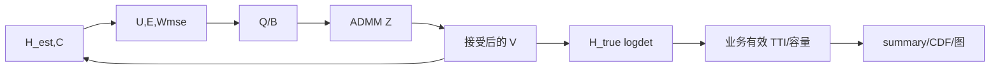

# 02 符号与变量去向

下表的“首”依次给配置/赋值/物理定义，`→` 后是最终消费者。令组 `g∈0..16`、组内 UE `k∈0..K_g−1`、全局 UE `u∈0..N−1`、TRP `l∈0..20`、接收行 `r∈0..3`、发射列 `n∈0..63`、流 `d∈0..rank−1`。Python 是零基，MATLAB 是一基。未逐项标单位者为无量纲。证据均为本轮源码 S，公式编号见 03。

| 数学符号 | 代码变量/别名 | 含义；维度/类型/单位 | 首次配置/赋值/物理定义 | 生成规则与后续使用 | 更新及最终去向 |
|---|---|---|---|---|---|
| `L,N,K_g,N_t,N_r,d` | `trps,users,users,tx_ports,ue_rx_ports,rank` | 21/210默认/组内人数/64/4/2；整数 | `config.py:7-71`/`Resource.users`/同处注释 | `users=21*users_per_cell`；`scenario.generate`/`solver`/`evaluate` | 只配置；写 `summary.scene_dimensions` |
| `t,T_s` | `decision_tti,duration_tti,tti_ms` | 决策 TTI/窗口/1 ms | `config.py:35-41` / `scenario.py:215` /事件时间 | SRS age、业务窗口；`run.py` summary/events | 静态配置，回放可另设窗口 |
| `B_g,a_g` | `rb_start,rb_count,tx_rb_count,_weight` | 组起点/宽/活跃RB数；`a_g=tx_rb_count/273` | `config.rb_groups` / `_schedule` / `solver.py:42-49` | 功率与谱效跨组加权 | 写 scene manifest、power、UE指标 |
| `x_l,x_u,h_l,h_u` | `trp_xy,ue_xy,home` | 坐标 `[21,2],[N,2]` m；归属 `[N]` | `scenario._geometry` / `_geometry` /部署位置 | 距离、扇区方向、服务集候选、增益 | 不优化；scene manifest；回放复制位置 |
| `A_{gli}` | `active,users_by_group,serve` | 资源启用、调度 UE ID、服务 mask `[21,K_g]` bool | `_schedule` / `generate` /同处 | 先规则选组/UE，再最近可用TRP服务 | 不随 WMMSE 更新；限制 V 非零；manifest/指标 |
| `\beta_{ul}` | `gains,prior_gain` | 大尺度链路增益 `[N,21]`，归一化 | `_link_gain` / `generate` /路径损耗 | CSI 先验、信道振幅、边缘固定权重 | 固定；诊断/`Resource`，未直接成为物理吞吐 |
| `H^{true}_{gklnr}` | `h_true,H_true` | `[K_g,21,4,64]` complex64；归一化信道 | `_channel` / `generate:227-255` /真信道 | 生成 CSI-RS/SRS 观测；pilot reuse 在 `srs_reuse.update_from_reused_pilots:10-99` 用它合成过去 SRS；直接求解仅 `ideal` 支；普通分支不直接读取真值做服务/权重/V 决策 | 场景固定；`evaluate.rates` 静态 SE/业务代理；`srs_observation_snr_diagnostic`；默认结果不单独保存完整 H 数组 |
| `\hat H_{gklnr}` | `h_est,H_est` | 同上，后验均值 | `generate` LMMSE / `Resource.h_est` | 非 ideal 的 SVD 与 U/W/V；区别真信道 | 固定求解；估计目标/导出 |
| `C_{gkl}` | `error_var,C_stat` | `[K_g,21,4,4]` complex64；接收侧误差协方差 | `generate` 后验 / `Resource.error_var` | `R_yy` 与 Q 的期望误差项 | 名义支置0、统一支替换、统计支原样；只影响求解代理 |
| `\tilde\beta` | `omitted_gain` | `[K_g,21]` 截断链路期望增益 | `generate` 距离阈值 | `evaluate` 计算遗漏干扰诊断 | 不补进 `rates` 分母；只记诊断 |
| `s_{gi}` | 未显式生成 | UE 复数据流 `[d,1]`，假设 `E[ssᴴ]=I` | 物理解释见 `solver.py` 顶部/未赋值 | 仅通过协方差 `GGᴴ` 隐含 | 无波形、调制、OFDM 数据数组；不保存 |
| `V_{gli}` | `vs,precoders,V_gXX` | 预编码 `[21,K_g,64,d]` complex128；幅度含 `√W` | `solver._initial` SVD / `Solution` /下行线性映射 | `H@V` → U/E/W、功率、真信道率 | ADMM 可行 Z 经回溯变为下一轮 V；NPZ/MAT，评价 |
| `G_{gki}` | `_effective:g` | `[K_g,K_g,4,d]` complex128；TRP 相干和 | `solver._effective:75-77` /同处 | `Σ_l H_kl V_li` | 每次状态重算；`R_yy`, SE，临时丢弃 |
| `R_{yy,k}` | `ryy` | `[4,4]` 复 Hermitian；噪声+全部信号+误差 | `_state:101` /同处 | `I+Σ_i GGᴴ+Σ_l P_l C_kl` | 每次 U 更新；不单独保存 |
| `U_{gk}` | `u,receivers,U_gXX` | 线性 MMSE 接收器 `[K_g,4,d]` complex | `_state:98-106` | `R_yy^{-1}G_kk` → E/Q | 每轮重算，最终 MAT/NPZ |
| `E_{gk}` | `e` | MSE `[d,d]` complex | `_state:107-108` | `I−UᴴG−GᴴU+UᴴR_yyU` | 临时；逆矩阵 W、代理率 |
| `W^{MSE}_{gk}` | `w,weights,W_gXX` | MSE 权重 `[K_g,d,d]` complex | `_state:109` | `E^{-1}`，再乘 UE 标量目标权重 | 每轮重算；最终保存。不是旧波束 `W` |
| `\omega_u` | `derivative,user_weights` | PF 标量 `[N]` 或组内 `[K_g]` | `_pf_derivatives:144` | `1/(R_u+floor)` 除以公共中位数；Q/B | 每轮重算；写 summary；非 MSE 矩阵 W |
| `M_k,B_{lk},D_l` | `m,b,err_diag` | Q 算子部件 `[K,4,4],[21,K,64,d],[21]` | `_quadratic_parts:114` | `U W Uᴴ`, `HᴴUW`, `Σtr(MC)` | 每轮更新；用于 CG；临时 |
| `X,Z,Y,\rho` | `x,z,y,rho` | ADMM 原变量/可行副本/缩放对偶，V 同形；罚参数标量 | `_solve_v_admm:227-233` | CG→投影→对偶；残差 | 每次外轮重置；返回 Z；轨迹写 summary |
| `r_c,p_c,\alpha` | `_cg:r,p,alpha` | 线性系统残差/搜索方向/步长，V 同形/标量 | `_cg:200` | Hermitian 复内积 CG | 局部临时，仅候选 X 进入 ADMM |
| `P_l,P_{max}` | `power_by_trp,power_watt_per_trp` | 每站平均辐射 W、默认20W | `config.py:17`/`solver.py:47` | `Σ_g a_g||V_gl||²` →投影/评价 | 每步更新；summary 和诊断 |
| `R_{gk},R_u` | `rates,per_ue_physical` | bit/s/Hz | `solver.rates:80`/`evaluate:98-106` | 真信道 logdet、跨组加权 | 静态 SE/体验容量；summary |
| `Q_u,D_u` | `volume,valid,exp_rate` | 代理 bit、有效 TTI、bit/s | `evaluate:113-139` | 活跃且非终止 TTI 的容量积分/有效时长 | 分位数/CDF/summary；不是 ACK RLC 计数 |
| `J` | `optimization_objective,proxy_rate` | 估计率或 PF 对数效用 | `_objective_snapshot:154` | 分支依赖；外轮接受与停止 | trajectory/summary；不等同真信道指标 |

冲突：2023 论文/代码小写 `v[k]` 是标量接收器，`w[k]` 是标量 MSE 权重，`mu_MR_WMMSE[l,k]=√p`；Python 新 `V` 是复预编码，`u` 是矩阵接收器，`w` 是矩阵 MSE 权重。旧 MATLAB `W` 是波束，旧 `Q` 是接收投影子空间；新文档 `Q` 指 Python 隐式二次算子。`cf_search.m` 中 `V` 是 PSO 粒子速度，不是预编码。2023 `q,g` 是 ADMM 副本/对偶，Python 新 `z,y` 扮演类似数值角色，但符号和约束都不同。MathWorks `W_k` 是 ZF 下行预编码，非 MSE 权重。

## 还要追的局部数学量

| 数学符号 | 代码变量 | 意义/轴与单位 | 首次生成 → 更新 → 使用 → 去向 |
|---|---|---|---|
| `N_{ULtx},N_{DLrx},d` | `ue_tx_ports,ue_rx_ports,rank,srs_ue_tx_to_rx_rows` | 默认 2/4/2；上行 2 端口仅映射 4 个下行接收行中的 `(0,1)` | `config.py:45-78` → 静态；`scenario.generate:239-250` SRS；`solver._initial:278-289` 用 `rank`。上限是 `min(tx_ports,ue_rx_ports)=4`，非 `ue_tx_ports=2`。 |
| `γ^{SRS}` | `pilot_snr_db`, reuse `signal_to_interference_plus_awgn_linear` | 前者参考 SNR dB，后者逐链路合成 pilot SINR 线性值/其 dB 分布；没有已定义的系统聚合 SINR | `config.py:19-21` → `scenario.generate:200-268`/`srs_reuse.py:10-99` → `evaluate.srs_observation_snr_diagnostic:8-82` → `summary.scenario`，不进普通 V 直接目标。独立 AWGN 模式只有观测 SNR。 |
| `\epsilon_{gkl},C_{gkl}` | 观测噪声 `yc,ys,srs_noise`、`residual,empirical,posterior` | 噪声样本 `[4,64]`、`[2,64]`；校准残差 `[4,5000]`，经验/解析协方差 `[4,4]`，复数归一化信道平方 | `scenario.generate:235-255` 和 `_calibrate_independent:129-153` → 后验 `h_est,error_var` → `_state/_quadratic_parts`；校准误差写 `summary.scenario.independent_calibration`，样本本身不保存。 |
| `S_{gk},I_{gk}` | `g[k,k]@g[k,k].conj().T`, `interference` | 有用/干扰接收协方差各 `[4,4]`，单位噪声归一化 | `solver.rates:80-91` 每次由 `H,V` 重算 → 两个 logdet → 真信道每组 SE；无持久化逐项数组。`rates` 中不叠后验误差。 |
| `\widetilde Y` | `y` | ADMM **缩放**对偶，与各组 V 同形；未缩放对偶 `λ_ADMM=ρy` 未作为数组存放 | `_solve_v_admm:230` 零初始化 → `:248` 加 `X−Z`，`ρ` 改变时 `:268-275` 重缩放 → 内层停止 `eps_dual`；仅残差/ρ写轨迹。注意它不是接收信号 `y_k`。 |
| `r_{pri},r_{dual}` | `primal,dual,epsp,epsd,cg_relative` | 全组 Frobenius 范数及门槛，标量；`dual=ρ||Z−Z_old||` | `_solve_v_admm:249-264` 每内轮更新 → 联合停止；记录 `admm_trace` 和 summary 末值。 |
| `R_u,f,\omega_u` | `per_ue`, `pf_rate_floor_bits_per_s_hz`, `derivatives/user_weights` | 全局 `[N]` bit/s/Hz、正标量 floor bit/s/Hz、每 UE/组无量纲权重 | `_aggregate_user_rates:136` → `_pf_derivatives:144` 每外轮更新 → `_quadratic_parts:114`；目标和最终权重进 summary。只在 PF 分支按此式。 |

## 工程索引，不是数学变量

`g` 是资源组循环下标，`k/ki` 是组内 UE 下标，`u` 是全局 UE ID，`l` 是 TRP 下标，`i` 在 `_effective` 表示**数据流所属 UE**；`r,n,d` 在 `einsum` 下标分别为接收行、发射端口、流。它们本身不存结果。`output`/`progress_path` 是文件路径；`record`/`trajectory` 是日志字典，不是优化状态。`run.py:238-299` 的 `arrays['V_00']` 等是保存键，组下标零基；MATLAB 读取后按结构体字段取，不会自动交换数组轴。

旧 `cf_evaluate_candidate.m` 的精确映射：`H[Nr,M,R,U,G]` 是估计信道；`bInit/bFinal[R,U,G]` 是服务掩码，`rankUG[U,G]` 是流数，`Q[Nr,U,G,Smax]` 是**接收投影子空间**，`W[M,Smax,R,U,G]` 是波束，`p[R,U,G]=Σ_s||W||²` 是从波束导出的功率而非独立求解变量。`lambda,mu[R,G]` 是旧 inner 的负载/功率乘子，`alpha[R,U,G]=1/(p+epsilon)` 是重加权稀疏因子，`delta[U]` 是率驱动用户权重，`zeta[S,U,G]` 是二次变换辅助变量；它们进 `updateBeamformers`，轮末 `lambda/mu/delta` 更新，最终仅在 `history/diagnostics` 留痕或被覆盖。`SLINR[S,U,G]` → `ratePerStream` → `userRate` → `SumRate/J_true`/体验代理/结果表。原生条件适配器则消费 `scenario.H_est/H_true`，以 `H/sqrt(noisePower)` 归一到单位噪声，`scheduleMask[U,G]` 固定调度，按 `numConnections` 选估计增益最高服务链，把 `candidate.maxRank` 送入矩阵求解；其他7个候选维度不实现，偏离默认即报错。[`cf_evaluate_candidate.m:1-188,189-381`; `cf_chasi_native_resources.m:1-115`]

