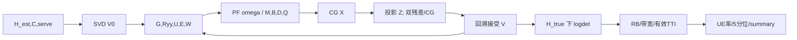

# 04 从发送、WMMSE、ADMM 到 UE 指标

以 Python 默认 210 UE、21 TRP、64 下行 Tx、4 下行 Rx、rank 2、17 资源组为例；某组只含 `K_g` 个排定 UE，故以下矩阵必须写 `K_g` 而不是固定 210。公式号见 03。代码并不生成调制符号或 OFDM 波形；发送/接收式是从协方差计算还原的通信模型。[S,M: `solver.py:1-111`]

1. **数据与发射。** 假设每个 UE 的两维流 `s_i∈C^{2×1}` 独立、零均值、单位协方差。TRP `l` 发 `x_l=Σ_i V_li s_i∈C^{64×1}`（C15）；服务 mask 以 `V_li=0` 限制非服务链路。`V_li∈C^{64×2}` 的列是每条流的 64 端口复幅相。相同 UE 的 `s_i` 在多个服务 TRP 复用，因此 `Σ_l H_kl V_li` 是相干和，隐含相位/时间同步；代码没有模拟同步误差。[`scenario.py:219-226`, `solver._effective:75-77`]
2. **接收与干扰。** UE k 的抽象接收向量 `y_k=G_kk s_k+Σ_{i≠k}G_ki s_i+n_k`，`G_ki=Σ_l H_kl V_li∈C^{4×2}`。这里先跨站复数相加再算 `G Gᴴ`，不是各站功率相加。接收协方差 `R_yy=I_4+Σ_iG_kiG_kiᴴ+Σ_l||V_l||² C_kl`；最后一项为求解器对误差的期望，不是最坏情况椭球。[C16–C17；`_state:94-105`]
3. **初始化不决定最终预编码类别。** 每条可服务链对 `Ĥ_kl∈C^{4×64}` 做 SVD，取右奇异向量前 d 列，得到方向；再作跨组每站 20 W 投影（C14、C29）。矩阵分支随后自由更新所有被允许的复矩阵元素，故最终是**固定服务集合和 rank 的复矩阵 WMMSE 预编码**，不是 MR/RZF 或固定方向功控。`no_cooperation` 仅用 home TRP 的本地 SVD，固定方向支 `V_li=μ_li D_li` 优化实标量 μ；这两支不能替代矩阵支解释。[`solve:291-342,444-592`]
4. **方向、幅度、相位与功率。** `V` 的复条目同时决定方向、相位和幅度，功率 `P_l=Σ_g a_gΣ_i||V_gli||²`。矩阵支没有额外逐链路功率变量；给 `V` 再乘一个 `√p` 会重复计功率。`power_watt_per_trp=20` 是跨所有组的加权预算，`a_g=tx_rb_count/273`。[C07、C29；`power_by_trp:47-49`]
5. **接收器、MSE、权重。** 对给定 V，`U_k=R_yy^{-1}G_kk∈C^{4×2}`；`E_k=I_2−UᴴG_kk−G_kkᴴU+UᴴR_yyU∈C^{2×2}`；`W_k=E_k^{-1}∈C^{2×2}`。最小 MSE 接收器下 `−log₂det E` 是该代理的 bit/s/Hz。PF 分支另外计算标量 `ω_u∝1/(R_u+f)`，由全局 UE 跨组估计率决定；它乘 W 后进入 V 的二次子问题，不能把 `ω` 叫作接收器或 MSE 权重矩阵。[C18–C24；`_state`, `_pf_derivatives`]
6. **固定 U/W 的 V 子问题。** `M_k=U_k(ω_kW_k)U_kᴴ∈C^{4×4}`、`B_lk=H_klᴴU_k(ω_kW_k)∈C^{64×2}`、`D_l=Σ_k tr(M_kC_kl)`。隐式算子 `Q(V)_li=Σ_k H_klᴴM_kΣ_jH_kjV_ji+D_lV_li` 与 V 同形。最小化 `Σ_g a_g(〈V,QV〉−2Re〈B,V〉)`，加 `V_li=0` mask 与每站 20W 球约束（C24–C26）。这里 `Hᴴ` 是共轭转置，`〈A,B〉=Σ conj(A)B`；不能用普通转置。二次式是固定 U/W 的局部子问题，不是原非凸总问题的全局解。
7. **ADMM 与 CG。** 分裂为无约束原变量 X、满足 mask/预算的 Z、缩放对偶 Y。CG 近似解 `(a_gQ_g+ρI/2)X_g=a_gB_g+ρ(Z_g−Y_g)/2`，按复 Hermitian 内积更新残差/方向。`Z=Π_C(X+Y)` 按每站共享乘子 λ 投影所有组，`Y←Y+X−Z`；ρ 每10轮可按原/对偶残差比调节，并同步缩放 Y。[C27–C30；`_cg:200-215`, `_solve_v_admm:227-275`]
8. **返回哪一个变量。** `_solve_v_admm` 返回 `z`（可行副本）而非最后一次 `x`。主外轮以 `Vtrial=Vold+α(z−Vold)` 最多12次半步，检查估计目标不下降；接受后成为下轮 V，不接受则旧 V 保留。最后重新算 U/W；`converged` 还要求目标变化、V变化、最近 ADMM 收敛三条件。达轮数上限或局部残差达标均不证明全局最优。[`solve:353-441`]
9. **物理评价。** `evaluate` 固定最终 V，用 `H_true` 重算 `G` 和 `logdet` 真信道静态谱效，**不再叠加后验误差协方差**。按 RB 权重转为 UE bit/s/Hz，再乘 12 子载波、30 kHz、RB 数与 TTI 秒得到理论容量 bit，叠加业务 busy/tail/terminal 门控，得到有效 TTI 分母、UE Mbps、分位数与 CDF 候选。这是容量/队列代理，不含显式 DL 比特、调制、信道译码、ACK RLC 计数。[C32–C37；`evaluate.py:91-183`, `protocol_contract.py`]

**物理限制。** 干扰 `G_ki` 只包含该组显式建模的 K_g 个用户；距离截断的链路仅另算遗漏干扰诊断，没有加回 `rates` 分母。默认 noise 单位阵是归一化假设，`noise_watt_per_rb` 用于特定 pathloss subset 的增益归一化，不应同时再加一次噪声瓦数。当前值是理论速率/业务代理，不能称链路级 BLER 或正式体验验收。
