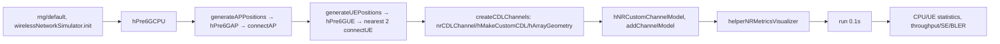

# 05 MathWorks Cell-Free 示例：可见源码与版本边界

**版本证据限制。** 用户指定 [R2025a 中国站 URL](https://ww2.mathworks.cn/help/releases/R2025a/5g/ug/evaluate-performance-of-cell-free-mmimo-networks.html) 及 `www.mathworks.com/help/releases/R2025a/...` 在本轮网页工具均返回抓取错误。实际逐段读取的是 [MathWorks 当前在线页面](https://www.mathworks.com/help/5g/ug/evaluate-performance-of-cell-free-mmimo-networks.html)，页眉标 `R2026b`、`Since R2024b`。因此下面可确认“当前页可见脚本/说明”，**不能断言 R2025a 每个默认值和 helper 内部实现完全相同**。本机未定位到 R2025a 安装目录或示例 helper 文件；`F:\bin\matlab.exe` 存在但未启动，以免干扰运行任务。`hPre6GCPU` 等内部 helper 只按页面的输入输出和官方文字描述，不能称逐行源码已审。[S/O/?]

## 当前页面主脚本调用链

页面主脚本：`rng(default)`、10个10ms帧；1000×1000m，20 AP、4 UE、每 UE 最近2 AP；CPU 坐标 `[500,1100,10]`；AP 局部函数将区域分成网格并在每格扰动，固定高30m，UE 局部函数按四象限随机放置，固定高3m；这些是当前页实际局部函数规则，非均匀全域独立随机散点。CPU 1.9GHz、20MHz、15kHz SCS、4 Tx/4 Rx、SRS periodicity=5；AP 23dBm、4 Tx/4 Rx、噪声系数9dB；UE 20dBm、1 Tx/1 Rx、噪声系数9dB；TDD、`full-phy`、当前默认 `Centralized`。`connectUE(...,FullBufferTraffic="on")` 产生满缓冲业务。`channels` 是 N×N cell；`createCDLChannels` 对 AP/UE 建双向 `nrCDLChannel`，延迟扩展300ns，采样率从 `nrOFDMInfo` 取得，DL 链路克隆 custom CDL、按 UE 设 seed、设置天线几何和到达/出发角，再 `swapTransmitAndReceive` 形成 UL。`run(networkSimulator,0.1)` 后 `CPU.statistics`, `UEs.statistics`, `displayPerformanceIndicators` 报 UL/DL cell throughput、SE、BLER。[O: 官方当前页 Scenario Configuration、Local Functions]

## 官方明示模型和符号

| 编号 | 公式/变量与维度语义 | 页面位置/去向 | 可见性 |
|---|---|---|---|
| O01 | `Ĥ_k^ul=[(H_{m1k}^ul)^T ... (H_{mnk}^ul)^T]^T`，多个服务 AP 的 UL 信道按 AP 天线轴堆叠；数值维度依 AP 数和天线数 | SRS Processing → CPU 可用 CSI | 官方明示；估计实现内部不可见 |
| O02 | `W_k=(((Ĥ_kᴴĤ_k)^−1)Ĥ_kᴴ)ᴴ`，ZF DL 预编码；`W_k` 非本项目 MSE 权重 | Precoder Computation → PDSCH | 官方明示；逆矩阵病态处理未见 |
| O03 | `X_m^dl=Σ_{k served by m}X_k^dl`，AP 叠加所有 UE 波形 | PDSCH Processing | 官方明示；编码/功率缩放内部不可见 |
| O04 | `W_k=[W_{m1k}^T ...]^T`，集中 W 分配到 AP | PDSCH 分布式路径 | 官方明示 |
| O05 | `LLR_k=Σ_{m∈M_k}LLR_{mk}`，分布式 UL LLR 合并 | PUSCH Processing → TB decoding | 官方明示 |

当前页明确：下行/上行利用 TDD 互易的 SRS，**信道系数为从 channel path gains/path filters 得到的完美估计**，未模拟 CSI-RS；集中方式 CPU 做 PHY、AP 中继波形，分布式方式 CPU/TB 与 AP PHY 分工；UL TPMI 基于码本，UL 接收含 CP 去除、FFT、LS 估计、MMSE 均衡、层解映射、解扰、LLR、TB 解码。页面说明这些模块的功能，不暴露 helper 的完整调度、链路预算、噪声采样、MCS/HARQ、精确吞吐公式；不能据此补造内部细节。[O]

| 变量/对象 | 创建→传递→终点 | 范围 |
|---|---|---|
| `numFrameSimulation,phyModelType,split` | 主脚本→`run`/CPU/自定义信道→0.1s 指标 | 当前页主脚本 |
| `apPositions,apRadius,uePositions` | 本页局部函数→AP/UE node、最近距离排序→网络与可视化 | 位置分布的具体局部函数可见；内部 node 处理不可见 |
| `closestAPIdx,numUEConnections` | 欧氏距离排序→两次 `connectUE`→服务集 | 只确认初始连接，不等于本项目联合优化 |
| `channels,channelConfig,cdlChannel` | `createCDLChannels`→自定义信道对象→网络收发包 | CDL 内部实现不可见 |
| `W_k,X_m^dl,LLR` | 官方公式→CPU/AP PHY helper→统计 | 公式明示，helper 源码本轮不可读 |
| `cpuStats,ueStats,metricsVisualizer` | `statistics`/可视化→吞吐/SE/BLER | 当前页输出，非本项目体验率 |

支持 helper 列表：`hPre6GCPU`, `hPre6GCPUMAC`, `hPre6GCPUFullPHY`, `hPre6GScheduler`, `hPre6GAP`, `hPre6GAPLowPHY`, `hPre6GUE`, `hPre6GUEMAC`, `hPre6GUEFullPHY`, `helperNetworkVisualizer`, `hArrayGeometry`, `helperNRMetricsVisualizer`, `hNRCustomChannelModel`, `hMakeCustomCDL`, `hNRKPIManager`。它们的名称和官方功能摘要可见，但本机未取得源码；以上流程图不能被读作内部调用图已全部核实。
