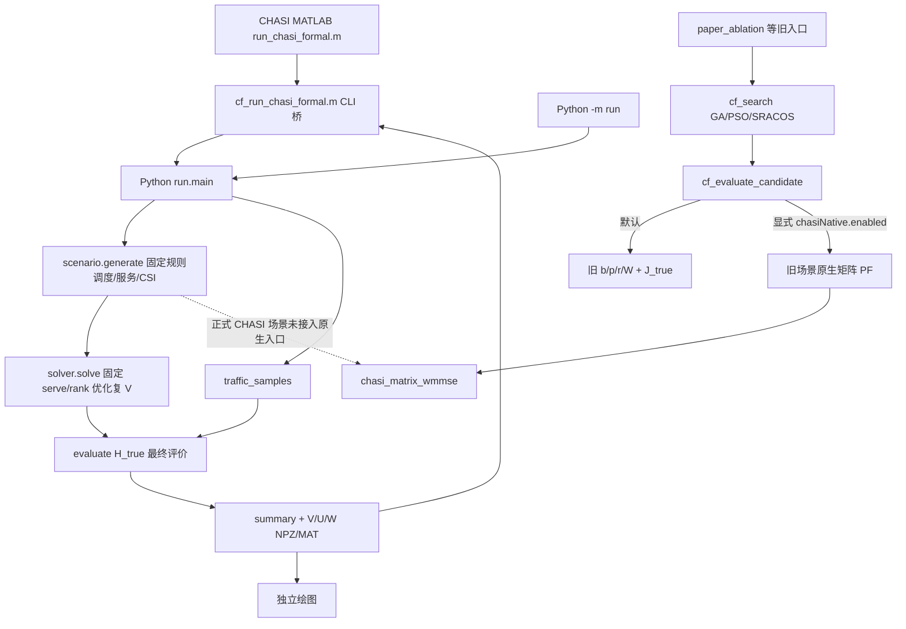
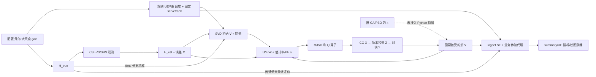

# 代码阅读导航与公式溯源（2026-10-15 核查）

## 下午先从这里读

**整体做什么。** 仓库有旧 MATLAB `b/p/r/W` 候选评价＋GA/PSO/SRACOS 搜索，以及 CHASI 固定调度/服务集合/rank 后的复矩阵 WMMSE＋集中式 ADMM 求解。两链的目标、信道和功率约束不同。**真实运行主线**是 [`run_chasi_formal.m`](../../experiments/chasi_formal/run_chasi_formal.m) → [`cf_run_chasi_formal.m`](../../matlab/core/cf_run_chasi_formal.m) 的 `system()` → Python [`run.main`](../../chasi_formal_implementation/run.py) → `scenario.generate` → `solver.solve` → `evaluate.evaluate` → JSON/NPZ/MAT。MATLAB 只拼 CLI 标量并读回结果，复数 H 在 Python 生成。

**下午打开顺序**：`config.py:7` → `run.py:34` → `scenario.py:87,155` → `solver.py:75,94,227,291` → `evaluate.py:91`。先画一组的 `H[K_g,21,4,64]`、`V[21,K_g,64,d]`、`U[K_g,4,d]`、`W[K_g,d,d]`，再读循环。**第一遍跳过** `time_evolution.py` 可选回放、`ellipsoid.py` 限定子问题检查、`compare_*/audit_*/diagnose_*` 后处理、绘图脚本和旧 GA/PSO 算子；读完 CHASI 主线后再看旧链。

这里的“正式”指仓库 CHASI 可执行入口，不等于华为验收。行号来自本轮工作树；晚近未提交源码可能改变行号。细节接续：[01 实际框架](01_真实框架.md) → [02 符号字典](02_符号字典.md) → [03 公式索引](03_公式索引.md) → [04 预编码全程](04_预编码全程.md) → [06 三方来源](06_三方来源对照.md)。旧状态文件的 2026-09-02 快照不能代替本轮源码核查。

**Git 可用性边界：** 本轮工作树中的 `chasi_formal_implementation/`、`experiments/chasi_formal/run_chasi_formal.m` 和原生迁移夹具仍未跟踪；本导航按本地真实源码核查，相关相对链接在当前本地仓库可打开，在仅检出本次文档提交的远端仓库暂不能打开。本轮没有擅自提交这些既有未提交资产。

## 实际连通状态

| 链 | 入口和关键调用 | 本轮核查结论 |
|---|---|---|
| CHASI MATLAB→Python | `experiments/chasi_formal/run_chasi_formal.m:1-37` → `matlab/core/cf_run_chasi_formal.m:1-70` → `chasi_formal_implementation/run.py:34-316` | 实际连通；MATLAB 默认 ADMM 80 次，Python CLI 默认 12 次，保存结果须看 `summary.config`。 |
| CHASI Python 正式求解 | `run.main:98-315` → `scenario.generate:155-284` → `solver.solve:291-441` → `evaluate.evaluate:91-183` | 场景、SRS/CSI、矩阵求解和最终评价闭环。默认分支含 ideal/nominal/statistical/no_cooperation/fixed_direction；PF 分支须显式指定。 |
| MATLAB 原生矩阵 PF | `cf_evaluate_candidate.m:4-6` 显式 `cfg.chasiNative.enabled` → `cf_evaluate_chasi_native_candidate.m:1-40` → `cf_chasi_native_resources.m:1-115` → `migration_20261013/chasi_matrix_wmmse.m:1-126` | 条件接入**旧 MATLAB 场景/搜索**，不在上述 CHASI 21TRP 入口内。5 个 2×2×2 夹具与 4 TRP 烟测见[迁移核查](../../experiments/chasi_formal/migration_20261013/native_pf_20261014/README.md)；未见 210 UE 原生端到端对拍。 |
| 旧外层 | `paper_ablation/run_controlled_outer_ablation.m:1-129` → `cf_search.m:134-171` → `cf_decode_candidate.m:1-39` → `cf_evaluate_candidate.m:1-188` | 默认旧后端连通，目标是旧 `J_true`/scheduled sum rate。SRACOS 在 `cf_sracos_guided_adaptive_gapso_search.m`，不是 Python `run.py` 外层。原生条件后端目标改估计 PF，仅 `numConnections,maxRank` 两维进求解；其余七维偏离默认时报错。 |
| 独立工具 | `native_pf_20261014/prepare_compare.py`、`run_matlab_compare.m`、`verify_compare.py`、`verify_operator.py`、`test_formal.py`、`final_figures_20261014/plot_final.py` | 夹具、局部验证、保存数据绘图分别运行，不是正式规模验证。`export_scene_to_matlab.py` 不被当前原生适配器调用。 |

**推荐阅读 Python CHASI 链。** 它完整覆盖今天要追的场景→信道→SRS→WMMSE/ADMM→指标。原生 MATLAB 模块最后读：它迁移了矩阵求解小例，还未迁移正式 CHASI 场景、SRS、业务协议。旧 MATLAB `W` 是波束，新 Python `w` 是 MSE 权重，先读旧链容易混淆。

## 逐文件路线

执行时 `scenario.generate` 先规则调度，再为各组生成 `H_true`、观测、`H_est` 和后验协方差；`run.main` 另取业务样本、逐分支 `solve`、真信道评价与保存。下面是便于理解的阅读顺序。`K_g` 为第 g 组排定 UE 数，`L=21,N_t=64,N_r=4,d=rank,N=21×users_per_cell`；Python 零基，MATLAB 一基。C 编号见[03](03_公式索引.md)。

| 顺序 | 文件与函数 | 先读行号 | 解决什么问题 | 输入→输出、维度/单位 | 公式 | 接下来 |
|---|---|---|---|---|---|---|
| 1 | [`config.py` `Config`](../../chasi_formal_implementation/config.py) | 7-55、61-88、91-98 | TRP/UE/天线/RB/rank/预算 | 配置→标量 `N,L,Nt,Nr,d`，17 组 RB，20 W/TRP | C07 | 2 |
| 2 | [`run.py` `main`](../../chasi_formal_implementation/run.py) | 34-131、138-191、191-315 | 参数覆盖、调用与输出 | CLI→`Config,Scenario,traffic,Solution`→JSON/NPZ/MAT | 入口 | 3 |
| 3 | [`scenario.py` `Resource,_geometry,_schedule`](../../chasi_formal_implementation/scenario.py) | 10-36、38-52、87-128 | 站/UE/资源组及固定调度 | 坐标 `[21,2],[N,2]` m→`users[K_g],serve[21,K_g]` bool | C01-C02,C07-C09 | 4 |
| 4 | [`scenario.py` `_link_gain,_channel,generate`](../../chasi_formal_implementation/scenario.py) | 54-84、155-199、203-235 | 增益、真信道、截断 | `gains[N,21]`→`h_true[K_g,21,4,64]` complex | C03-C06,C13 | 5 |
| 5 | [`scenario.py` `generate`](../../chasi_formal_implementation/scenario.py)、[`srs_reuse.py` `update_from_reused_pilots`](../../chasi_formal_implementation/srs_reuse.py) | 199-284；reuse 时 10-99 | CSI-RS/SRS 观测、年龄、后验误差 | `H_true`→观测→`h_est[K_g,21,4,64]`,`error_var[K_g,21,4,4]` | C10-C12 | 6 |
| 6 | [`solver.py` `_initial,solve`](../../chasi_formal_implementation/solver.py) | 278-342 | 固定 serve/rank 后的初始 V/CSI 分支 | `H,serve,d`→`V_g[21,K_g,64,d]` complex/√W | C14 | 7 |
| 7 | [`solver.py` `_effective,rates,_state`](../../chasi_formal_implementation/solver.py) | 75-112 | 相干发送、干扰、U/E/W/SE | `H,V`→`G[K_g,K_g,4,d]`,`U[K_g,4,d]`,`E/W[K_g,d,d]` | C15-C20,C32 | 8 |
| 8 | [`solver.py` `_aggregate_user_rates,_pf_derivatives,_objective_snapshot`](../../chasi_formal_implementation/solver.py) | 136-190 | 跨组 PF、floor、目标 | 组率→`R[N]` bit/s/Hz→`J`、`ω[N]` | C21-C23 | 9 |
| 9 | [`solver.py` `_quadratic_parts,_q_apply`](../../chasi_formal_implementation/solver.py) | 114-124、192-198 | 固定 U/W 的 V 子问题 | `U,W,H,C,ω`→`M[K_g,4,4],B[21,K_g,64,d],D[21]` | C24-C26 | 10 |
| 10 | [`solver.py` `_project,_cg,_solve_v_admm`](../../chasi_formal_implementation/solver.py) | 52-73、200-276 | CG、X/Z/Y/ρ、跨组功率与双残差 | `X,Z,Y` 同 V 形；`P[21]` W→可行 Z | C27-C30 | 11 |
| 11 | [`solver.py` `solve`](../../chasi_formal_implementation/solver.py) | 343-441 | 外轮接受、回溯、停止 | `Z,V_old`→`V_new,Solution`/轨迹 | C31 | 12 |
| 12 | [`evaluate.py` `evaluate,srs_observation_snr_diagnostic`](../../chasi_formal_implementation/evaluate.py)、[`protocol_contract.py` `cdf_candidates`](../../chasi_formal_implementation/protocol_contract.py) | 8-82、91-183；10-40 | 真信道率、业务有效时长、分位数 | `H_true,V,traffic`→UE bit/s/Hz、体验 Mbps、CDF、功率 | C32-C36 | 13 |
| 13 | [`run.py` `main`](../../chasi_formal_implementation/run.py)、[`plot_final.py`](../../experiments/chasi_formal/final_figures_20261014/plot_final.py) | 191-315；1-40、58 起 | 日志/数组保存、图表来源 | `Solution,metrics`→summary/events/manifest、V/U/W；绘图读存档 | 输出 | 旧链对照 |

下午主线约 **8 个 Python 文件的指定片段，2.5–4 小时**：先读 1–8、10–12。逐式深读 9、CG/ADMM、reuse、旧链和来源审计约再需 **1–2 天**，不能在一下午通读所有源码。

## 精简目录与两张图

```text
chasi_formal_implementation/       CHASI Python 场景、测量、求解、评价
experiments/chasi_formal/          MATLAB 桥入口、迁移夹具、后处理与图
  migration_20261013/            原生矩阵模块与小例对拍，非正式入口
matlab/core/                       旧 MATLAB 场景/搜索/评价、条件原生适配器
experiments/paper_ablation/        旧 J_true 消融入口
research-experiments/             历史研究批次与证据
APCC_experiments/                  独立 APCC 批次
results/                           运行结果与状态索引
docs/full_trace_20261014/         本导航及变量/公式/来源展开
tests/                            MATLAB/Python 烟测
```





## 字母和公式怎样串

核心变量的生成/更新/使用/去向见[02](02_符号字典.md)，公式与来源见[03](03_公式索引.md)。沿 C14→C15→C16→C17→C18→C19→C24→C25→C28→C29→C31→C32→C34，再对照[04 的完整 V 链](04_预编码全程.md)。关键轴变换是 `_effective` 的 `einsum('klrn,linq->kirq')` 跨 TRP 相干求和，`H.conj()`/`U.conj().T` 的复共轭，以及 `_weight=tx_rb_count/273` 跨组聚合。MATLAB 适配器 `cf_chasi_native_resources.m:70-90` 用 `reshape` 把旧 `[N_r,N_t,L,U,G]` 切片改为 `[K_g,L,N_r,N_t]`，并按 `sqrt(noisePower)` 归一。

五个先懂的符号：`H_true/Ĥ/C`，`serve`，`V`，`U/E/W`，`a_g=tx_rb_count/273` 与 `J_PF=Σ_u log(1+R_u/f)`。`rank≤min(64,4)` 且当前默认 2；UE 的 2 个上行 Tx 只限定 SRS 观测行映射，不能解释为下行最多两流。普通非 ideal 分支不用 `H_true` 直接选服务、初始化、算权重或更新 V；但 **H_true 生成 CSI 观测**，reuse 模式还用它合成过去 SRS，`ideal` 分支直接用真值求解，最终评价再用真值。因此“仅最终评价用 H_true”不准确。

2023 标量固定 MR 方向参考的 `μ=√p`、标量接收器 `v`、标量权重 `w` 与当前多流复矩阵 `V/U/W` 不是同物；旧 `cf_search.m` 的 `V` 是 PSO 速度，旧 `cf_evaluate_candidate.m` 的 `W` 是波束。当前 C17-C29 的用户中心相干和、误差协方差、跨组预算属于项目重推；C01-C13/C21-C23/C33-C38 多为建模/KPI 假设；C30-C31 为数值处理。未逐页核对的参考论文公式编号不猜。代码没有显式发射符号/OFDM 波形、真实 DL ACK/RLC、分布式 TRP ADMM。详见[03](03_公式索引.md)、[04](04_预编码全程.md)、[06](06_三方来源对照.md)。

**待核对差异。** 旧 README/状态文件以旧消融为“当前”，而晚近 CHASI 入口已存在；以具体入口区分。原生适配器的旧 SRS 标量误差不等于 Python 每链 `[4,4]` 后验，小例对拍不能推出正式场景等价。默认 `legacy_random_full_groups` 允许各 TRP 组占用不完全共享 RB，同组一个 V 的干扰模型因此为近似；`precise_shared_rb` 才共享 RB 位置。静态 SE、业务体验代理与正式验收 KPI 分开。

## 本轮清理记录

| 路径 | 处理 | 依据 |
|---|---|---|
| `docs/full_trace_20261014/README.md` | 更新为统一导航 | 01–08 的已有材料可作为展开，避免再造重复报告。 |
| `chasi_formal_implementation/__pycache__/`、`paper_edit/__pycache__/`、`experiments/chasi_formal/vendor/cfproto/__pycache__/` | 待判断，保留 | `.pyc` 可再生，但可见 Python 进程且无法读取其命令行，不能确认占用。 |
| `experiments/chasi_formal/migration_20261013/fontlist-v390.json`、同图 TIFF/PNG/PDF/SVG | 待判断，保留 | 引用及独有性未逐件确认；多格式不等于重复证据。 |
| 未跟踪的 `APCC-NEW-results/`、`APCC_experiments/`、`research-experiments/`、`paper_edit/`、`output/`、`tmp/`、`audit/`、迁移夹具及日志/CSV | 待判断，保留 | 可能含唯一原始/负结果，不能靠 Git 恢复。本轮未删除。 |

本轮不移动源码、不改算法、不重跑正式实验。结果状态仍以各 manifest/summary 和 [`results/README.md`](../../results/README.md) 为准。

本目录以本轮可读源码为准。证据标记：`S` 静态源码，`R` 已保存运行记录（本轮未重跑），`M` 由源码作数学还原，`T` 理论说明而未实现，`?` 不可见或未证实。行号指本轮工作树。

阅读顺序：[01 实际框架](01_真实框架.md) → [02 符号字典](02_符号字典.md) → [03 公式索引](03_公式索引.md) → [04 预编码全程](04_预编码全程.md) → [05 MathWorks](05_MathWorks_R2025a.md) → [06 三方对照](06_三方来源对照.md) → [07 答辩问题](07_老师追问.md) → [08 覆盖与缺口](08_覆盖清单.md)。

这里的“正式”仅指仓库 CHASI 可执行入口及其结果结构，不等于华为正式验收。旧论文消融线、Python CHASI 线、独立 MATLAB 矩阵模块是不同链。运行参数优先于源码默认值；已有 `summary.json` 代表特定运行，不能外推。

本轮未运行 MATLAB/Python 求解或大规模实验。指定 R2025a URL 的网页工具抓取失败，官方页面可见证据只能限定为当前网页版本，详情见 05。[MathWorks 当前页面](https://www.mathworks.com/help/5g/ug/evaluate-performance-of-cell-free-mmimo-networks.html)。
